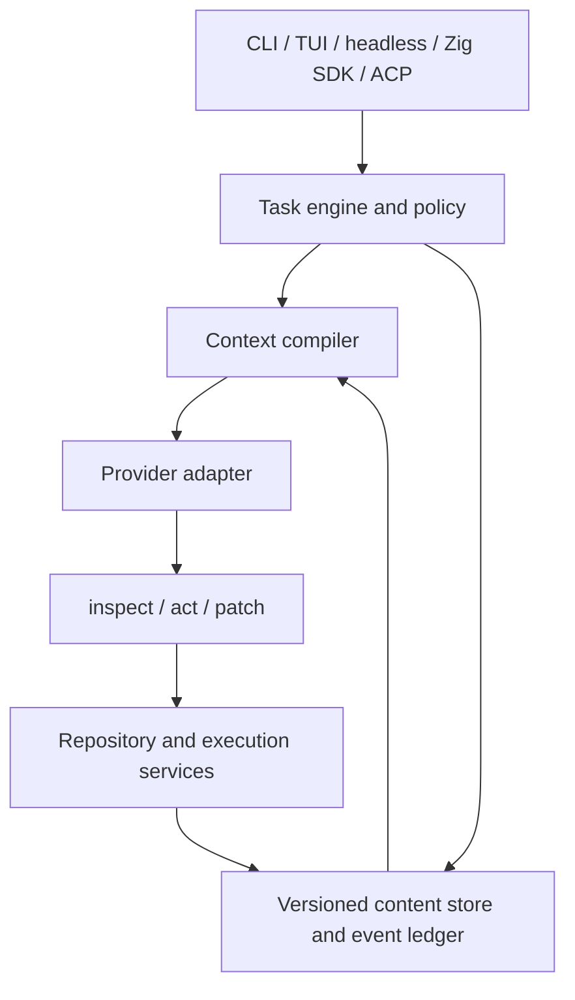

# ZeroRepeat: a complete Zig coding harness built around durable semantic state

## 1. Goal, constraints, and what “complete” means

Build **ZeroRepeat as a usable coding harness first**, then evaluate whether its context architecture improves **time to correct solution and tokens to correct solution**.

The first complete release includes the terminal application, headless execution, a Zig SDK, repository intelligence, editing and execution, permissions and sandboxing, durable sessions, memory, skills, plugins/MCP, subagents, and recovery. Desktop applications, custom IDE extensions, and web products remain later products; ACP provides an integration path for existing clients.

The project starts in the currently empty repository at `/Users/utkarshrajput/Documents/ChatGPT/Harness`.

The following decisions are locked:

| Area | Decision |
|---|---|
| First-party implementation | **Zig only**, including the runtime, context compiler, CLI/TUI, SDK, protocol adapters, orchestration, and tests. No Python implementation or Python prototype. |
| Toolchain | Pin Zig **0.17.0**, with verified download checksums and dependency revisions. It is a current stable release in the official download index. [Official Zig downloads](https://ziglang.org/download/index.json) |
| Native dependencies | Use established SQLite and Tree-sitter through their C interfaces. Use Zig’s BLAKE3 implementation. Do not introduce a Rust subsystem or custom database. |
| External tools | Git, ripgrep, language servers, containers, model servers, and official evaluators are external programs. Their implementation languages do not become ZeroRepeat implementation dependencies. ZeroRepeat itself must run without Python. |
| Base model | Use the official **`Qwen/Qwen3.8-27B` post-trained checkpoint** as the initial reference model. Pin weights, tokenizer, chat template, reasoning settings, and precision for each experiment. [Official model card](https://huggingface.co/Qwen/Qwen3.8-27B) |
| Initial platforms | macOS ARM64 for development and Linux x86-64 for Runpod and isolated execution. Other platforms remain explicit compatibility work. |
| Current cloud budget | **US$7 total**, reserved for functional validation after the local harness works. No paid benchmark campaign during construction. |
| Development priority | Correct end-to-end behavior, recovery, and context fidelity first; measured optimization follows. |

“Complete” means every requirement in the agreed release contract has an implementation and acceptance evidence. It does not mean undocumented behavior in every competitor has been discovered, or that “fastest” has already been established.

## 2. Preserve the plan and investigate every reference systematically

### Make repository records survive context compaction

The first implementation step is to save this entire specification and its verified sources into three repository records:

| Record | Required content |
|---|---|
| `docs/PLAN.md` | Goals, original requirements, constraints, architecture, interfaces, milestones, test strategy, source links, and dated decisions. Preserve the Zig-only requirement, US$7 ceiling, and build-first priority explicitly. |
| `docs/COVERAGE.tsv` | One row per requirement and discovered reference feature, with a stable ID, upstream revision, evidence, implementation disposition, owner subsystem, acceptance test, and status. |
| `docs/STATE.md` | Current commit, completed work, failing checks, unresolved decisions, pending jobs, cloud resource IDs and spending, and the next concrete work item. |

These records are canonical; chat summaries are navigation aids.

Before resuming after compaction or a new session, read these records and reconcile them with Git status and running jobs. Update them after each completed work unit. Corrections supersede earlier decisions explicitly.

Add a Zig coverage checker that rejects:

- Required features without acceptance tests.
- Features marked complete without supporting results.
- Unresolved required features at release time.
- References without a recorded disposition.
- Requirements removed without a recorded scope decision.

Every discovered feature receives one disposition: **implement, satisfy through an existing capability, explicitly defer outside this release, or investigate further**. Required core features cannot be silently deferred.

### Cover the entire supplied corpus

Follow the invoked [reverse-engineer-anything workflow](/Users/utkarshrajput/.agents/skills/reverse-engineer-anything/SKILL.md). Analyze available source with normal repository tools. Use REA for shipped artifacts and behavior that source does not establish.

| Investigation group | References and questions |
|---|---|
| Agent core, providers, sessions, plugins | [Pi](https://github.com/earendil-works/pi), [Codex CLI](https://github.com/openai/codex), [DeepSeek Harness](https://github.com/deepseek-ai/deepseek-harness), [OpenCode](https://github.com/anomalyco/opencode), [mini-swe-agent](https://github.com/SWE-agent/mini-swe-agent): trace the complete request → model → tool → state → next-request loop, cancellation, recovery, and extension boundaries. |
| Memory, continuity, skills, delegation | [Hermes](https://github.com/NousResearch/hermes-agent), [Prime Agent](https://github.com/PrimeIntellect-ai/prime-agent), [Deep Agents](https://github.com/langchain-ai/deepagents), [Qwen Code](https://github.com/QwenLM/qwen-code), [CSM/AgentBook](https://github.com/NovasPlace/CSM): trace memory promotion, evidence, compaction, checkpoints, skills, subagent isolation, and re-entry. |
| Repository representation and editing | [Aider](https://github.com/Aider-AI/aider), [Delta Context Engine](https://github.com/sohangujari/delta-context-engine), [Grove](https://github.com/Entelligentsia/grove), [Plandex](https://github.com/plandex-ai/plandex): trace indexing, ranking, context budgets, identity, invalidation, edit validation, accumulated changes, and rollback. |
| Execution and environment boundaries | [Goose](https://github.com/aaif-goose/goose), [SWE-agent](https://github.com/SWE-agent/SWE-agent), [OpenHands](https://github.com/OpenHands/OpenHands): trace process lifecycle, environment setup, permissions, sandbox isolation, remote execution, and agent/environment contracts. Follow OpenHands’ linked solver/runtime repositories separately from its current control interface. |
| Mature workflows and terminal behavior | [Cline](https://github.com/cline/cline), [Kilo Code](https://github.com/Kilo-Org/kilocode), [Crush](https://github.com/charmbracelet/crush), [Continue](https://github.com/continuedev/continue), [Roo Code](https://github.com/RooCodeInc/Roo-Code): inventory planning, modes, approvals, configuration, client coordination, terminal interaction, and recovery. |
| Output offloading and adaptive overhead | [Strands ContextOffloader](https://strandsagents.com/docs/user-guide/sdk/plugins/context-offloader/), [Microsoft TokenEconomizer](https://github.com/microsoft/TokenEconomizer): trace retrieval, eviction, missing-information risks, tool pruning, learned skills, repeated-failure handling, and cache interaction. |
| Shipped-product comparison | Inspect the named installed Claude Code, Codex, and OpenCode artifacts where needed. Record actual package/version/hash before analysis. Compare visible contracts and observed behavior; retain unknown server-side implementation details as unknown. |

For each feature, trace **entrypoint → callers → state changes → persistence → failure/permission paths → tests → observable outcome**. Record documentation-only evidence separately from source-established and runtime-observed behavior.

Important findings already affect the design:

- Pi, dsh, and Prime already contain durable context, event-derived model views, or re-entry digests. The research contribution must go beyond having a ledger and compiler. [Pi durable context](https://github.com/earendil-works/pi/blob/6c2fd73b0c545a4034672cb60e34d53e035dd751/packages/durable/src/harness/context.ts), [dsh sessions](https://github.com/deepseek-ai/deepseek-harness/blob/22ddee3792402c3e70ec5f86a63c3e3e895a2f60/packages/core/session/src/index.ts), [Prime harness digest](https://github.com/PrimeIntellect-ai/prime-agent/blob/7e3117ba85718ff618d104dd828f92cfa6d20640/crates/pa-core/src/session_engine/harness_digest.rs)
- Grove’s published symbol handles include location information; arbitrary cross-edit identity stability remains a separate problem. [Grove tools](https://github.com/Entelligentsia/grove/blob/main/docs/tools.md), [Grove vision](https://github.com/Entelligentsia/grove/blob/main/VISION.md)
- Crush’s current FSL license restricts competing use. Study behavior and architecture without copying restricted code into ZeroRepeat. Track licenses and attribution for every reused component. [Crush license](https://github.com/charmbracelet/crush/blob/main/LICENSE.md)
- Continue’s README declares it read-only and no longer actively maintained, despite its archive flag being false. Treat it and archived Roo as historical references. [Continue](https://github.com/continuedev/continue), [Roo Code](https://github.com/RooCodeInc/Roo-Code)

## 3. Architecture and implementation contract

Use one shared Zig runtime behind all interfaces:

### Correct context residency before delta optimization

The central invariant becomes:

> Omit an object only when its required representation is available in the next inference’s effective context, or when a continuing backend session explicitly guarantees its retention.

“Sent previously” is insufficient. A hash, handle, SQLite row, or model-state manifest cannot replace missing source bytes.

Support two execution paths:

1. **Portable default:** compile a self-contained, sufficient working context for each request.
2. **Backend continuation optimization:** reuse valid retained context or prefixes when the backend supports it; rehydrate after uncertainty, eviction, compaction, restart, model change, or branch divergence.

A semantic delta is valid only with an available base version. Otherwise send the replacement representation. Do not attempt arbitrary in-place KV modification.

Prefix caching reduces repeated prefill work; it does not make an incomplete stateless prompt sufficient. Measure logical context, cached work, wire bytes, and billing separately. [vLLM prefix caching](https://docs.vllm.ai/en/latest/features/automatic_prefix_caching/)

### Required subsystems

| ID | Subsystem | Implementation contract |
|---|---|---|
| ZR-01 | Task engine | Explicit task, plan, action, verification, completion, failure, cancellation, and waiting states. Preserve user corrections and unresolved obligations. Detect repeated failures and enforce aggregate time, token, tool-call, and delegation budgets. |
| ZR-02 | Provider layer | Start with OpenAI-compatible Chat Completions for Qwen; add Responses and Anthropic Messages adapters behind the same typed interface. Support streaming, tool-call assembly, cancellation, timeouts, retry classification, usage, reasoning controls, and attachments. Advertise tested capabilities and reject unsupported settings explicitly. |
| ZR-03 | Semantic objects | Represent files, symbols, blocks, results, errors, facts, decisions, plans, memories, tests, artifacts, graph nodes, tasks, changes, and verification records. Separate stable entity identity from immutable content hashes. Human handles such as `@S831:v17` resolve through project-scoped mappings. |
| ZR-04 | Durable storage | SQLite WAL for events, metadata, versions, relationships, sessions, branches, jobs, and retrieval indexes; immutable BLAKE3-addressed blobs for source/output/artifacts. Commit blob references only after durable blob creation. Include migrations, integrity checks, export, backup, and safe retention. |
| ZR-05 | Repository intelligence | Respect Git ignores and configured exclusions; inventory files, parse Tree-sitter symbols/imports, build provenance-bearing dependency/reference candidates, and integrate LSP when available. Provide L0 skeleton, L1 interfaces/relationships, and L2 source. Text search remains a fallback for unsupported languages and incomplete graphs. |
| ZR-06 | Incremental invalidation | Reconcile filesystem events, Git state, and content hashes. Re-index affected files and invalidate dependent views. Handle external edits, renames, deletions, branch switches, and watcher overflow. A missed-event recovery scan is allowed; correctness takes precedence over “never rescan.” |
| ZR-07 | Context compiler | Pin active requirements, applicable instructions, current task state, critical failures, and unresolved decisions. Select additional material using explicit references, text relevance, dependency distance, changes, and exposure history. Pack within a measured budget with output reserve; log why each unit was included, compressed, or omitted. |
| ZR-08 | Model-state manifests | Track effective-context generation, model/template identity, branch lineage, object/version/representation exposure, and backend continuation identity. Distinguish present, external/retrievable, superseded, and unavailable state. Never equate exposure with understanding. |
| ZR-09 | Result handling | Store complete permitted output with command identity, exit status, timing, truncation/redaction metadata, and source references. Return concise exception-first summaries. Support range, pattern, and surrounding-context retrieval. Unknown output formats must not be summarized as successful tests. |
| ZR-10 | Editing and Git | Validate expected versions and preconditions before applying changes. Support bounded replacements and unified diffs, multi-file change previews, syntax checks where available, and undo. Use a recovery journal for multi-file edits; detect conflicts rather than overwrite concurrent user changes. Reuse the Git CLI. |
| ZR-11 | Execution | Manage commands, PTYs, stdin, streaming output, background jobs, deadlines, cancellation, process groups, and exit status. Keep the runtime and parser/index workers alive. Offer explicitly scoped persistent shell sessions with clear cwd/environment behavior; preserve clean per-task execution for evaluation. |
| ZR-12 | Policy and sandboxing | Enforce filesystem, execution, network, credential, and plugin capabilities at the effect boundary. Every nested action passes the same policy checks. Use established container/OS isolation; never label an unrestricted process as sandboxed. Missing required isolation fails closed with a useful diagnosis. |
| ZR-13 | Memory and skills | Implement working, task, project, and global layers with provenance, scope, expiry/staleness, and supersession. Skills are discoverable and loaded on demand. Experience can propose versioned memories or skills; promotion requires supporting evidence and validation. Global behavioral changes are explicit and reversible. |
| ZR-14 | Subagents and branches | Compile bounded task capsules containing only relevant requirements, source, decisions, and budget. Isolate writes in separate worktrees/workspaces. Return findings, evidence, candidate changes, and verification summaries. Share immutable stored objects; share backend cache only when supported. Aggregate budgets and propagate cancellation. |
| ZR-15 | Extensions and MCP | Use typed Zig contracts for built-ins and versioned subprocess boundaries for external extensions. Implement capability negotiation, initialization, calls, cancellation, failures, and shutdown. Support MCP stdio and HTTP transports with on-demand discovery and the same permission system. Avoid an unstable native shared-library ABI in the first release. |
| ZR-16 | User interfaces | Provide an interactive TUI and a plain non-TTY CLI, headless event output, and the Zig SDK. Include streaming status, plans, tool activity, diffs, permission decisions, context/token usage, jobs, session selection, resume, and errors. All interfaces use the same runtime and policy. |
| ZR-17 | ACP | Implement ACP v1 JSON-RPC over stdio in Zig: initialization, capabilities, sessions, prompts, updates, permission requests, cancellation, resume where advertised, and explicit model configuration. Keep diagnostics on stderr. [ACP specification](https://agentclientprotocol.com/protocol/v1/overview) |
| ZR-18 | Observability and distribution | Emit replayable events and complete usage/cost accounting, with configurable redaction and opt-in telemetry. Provide reproducible builds, dependency/license records, checksummed releases, configuration validation, and `doctor` diagnostics. |

Implement the model-facing tools as typed operations:

- **`inspect`** — query/read source, symbols, relationships, results, state, documentation, and available capabilities.
- **`act`** — execute a bounded sequence of commands or registered operations, including tests, builds, jobs, and delegation.
- **`patch`** — apply edits against explicit expected versions and return change evidence.

Avoid creating a large custom programming language inside `act`. Count schemas, operation descriptions, discovery, and examples when measuring tool overhead. Three tool names and a 200–300-token definition remain design hypotheses to test, not guaranteed improvements.

Public entrypoints are the interactive application, `run`, `resume`, session management, `inspect`, `doctor`, configuration/skill/plugin management, `acp`, and export. The SDK exposes the same task lifecycle and event stream. Version the headless and extension contracts.

Internally, use typed Zig structures, integer IDs, arenas, and SQLite’s typed storage. JSON belongs at configuration and protocol boundaries. Memory-map immutable blobs where useful; do not assume mutable repository files are safe immutable mappings. Dedicated Git daemons, custom storage engines, handwritten assembly, and manual SIMD remain profiling-driven optimizations.

## 4. Build sequence, experiments, and acceptance gates

### Milestones

| Milestone | Deliverable | Exit condition |
|---|---|---|
| M0 — Freeze the contract | Canonical plan, coverage matrix, state record, pinned toolchain/dependencies, source corpus manifest, and initial evidence. | Every supplied requirement and reference is registered; high-priority loop, context, edit, and sandbox contracts are traced. |
| M1 — Bring the harness to life | Headless Zig agent loop with a scripted Zig provider, repository inspection, validated patches, isolated command execution, streaming, cancellation, and budgets. | A complete inspect → edit → test → repair → verify workflow succeeds without manual state repair. |
| M2 — Make state durable | Object store, ledger, sessions, jobs, replay, expected-version checks, and crash recovery. | Restarting at injected failure points preserves obligations and does not repeat uncertain mutating actions automatically. |
| M3 — Build the context engine | Incremental index, L0/L1/L2 retrieval, output offloading, compiler, residency manifests, compaction, and re-entry. | Forced eviction/restart tests recover required information and reject stale references. |
| M4 — Complete the runtime | Memory, skills, evidence-based learning, subagents, plugins/MCP, and full policy enforcement. | Isolation, budgets, extension failure recovery, and evidence-carrying delegation pass acceptance tests. |
| M5 — Make it usable daily | TUI, plain CLI, SDK, ACP, configuration, diagnostics, export, packaging, and documentation. | The same task can be started, interrupted, resumed, inspected, and completed through supported interfaces. |
| M6 — Harden and optimize | Fuzzing, stress tests, local profiling, representative repository workflows, and real-model functional validation within the remaining cloud budget. | Every required coverage row has passing evidence; no unresolved data-loss, policy-bypass, or context-reconstruction defect remains. |

Audit the remaining reference features alongside these milestones. Do not delay the first working loop until every product has been exhaustively read, and do not declare the release complete while required audit findings remain unresolved.

### Local tests that must exist before cloud spending

Use Zig tests, deterministic fake providers, protocol fixtures, and disposable repositories.

| Test family | Required scenarios |
|---|---|
| Provider/protocol | Split streaming chunks, malformed tool arguments, disconnects, context-limit errors, rate limits, unsupported settings, duplicate responses, cancellation, and usage reconciliation. |
| Residency | Random per-run information survives compaction, restart, branch changes, and model changes through rehydration; omitted information is never assumed available. |
| Identity/invalidation | Move, rename, overload, edit, delete/recreate, and externally modify symbols. Ambiguous matches receive new identities rather than false continuity. |
| Editing/recovery | Stale versions, overlapping edits, Unicode/newlines, multi-file interruption, disk-full failures, and concurrent user edits. |
| Output handling | Decisive failures at the beginning, middle, and end of large logs; unknown runners; truncated output; binary data; parser failures. |
| Obligation preservation | Long scripted tasks with numbered requirements, corrections, cancellations, decisions, and pending jobs; force repeated compaction and restart. |
| Execution/security | Path traversal, symlink escapes, inherited secrets, nested-action policy bypass, plugin overreach, child-process cleanup, and unavailable sandbox backends. |
| Storage | Allocation failures, interrupted writes, orphan blobs, migrations, backup/restore, and retention that cannot delete live references. |
| Subagents | Conflicting changes, stale parent state, failed workers, cancellation, aggregate budget limits, and evidence that no longer matches current source. |
| Interfaces | Non-TTY operation, terminal resize, Unicode rendering, interrupted input, ACP fake-client conformance, SDK cancellation, and stable headless events. |

### Experiments during construction

Keep an ordinary transcript mode within the same Zig runtime as the control condition. Then compare incremental additions:

1. Output offloading.
2. Repository maps and symbol retrieval.
3. Compiled self-contained context.
4. Ledger-based re-entry.
5. Three-tool exposure versus equivalent conventional typed tools.
6. Subagent capsules.
7. Cache-preserving ordering and supported continuation.

Hold model, task, capabilities, and budgets constant. Measure the overhead introduced by indexing, retrieval, compilation, and additional model round trips.

Profile cold startup, warm context compilation, incremental indexing, large-output retrieval, process execution, memory use, and recovery. Accept optimizations only when measurements show an improvement without losing correctness or clarity.

A feature is complete when its user-visible workflow, failure paths, persistence, callers, and tests work together. A stub, a schema, or an isolated happy-path test is insufficient.

## 5. Runpod validation and later competitive evaluation

### Current US$7 stage: functional validation only

Keep cloud spending at zero through the local construction milestones.

The live Runpod reads on 25 October 2026 showed no pods or endpoints. The GPU catalog listed **`NVIDIA RTX PRO 6000 Blackwell Server Edition`**, 96 GB, Secure Cloud at **US$2.49/hour**, with aggregate availability `HIGH`. This is a sizing candidate; refresh price and placement before any deployment.

Once the local harness is ready:

- Use one short-lived Secure Cloud pod and a pinned compatible inference image.
- Serve the original Qwen checkpoint initially with a bounded context window and concurrency one. Validate actual memory use before increasing either.
- Test real streaming, tool calls, an edit/test loop, cancellation, compaction, and resume.
- Keep the total planned session below US$5, retaining US$2 for provisioning, storage, and teardown uncertainty.
- Record resource IDs, enforce elapsed-time and estimated-spend stop conditions, retrieve artifacts, and verify resource deletion. Budget guards must allow for billing and control-plane delays.
- If the setup fails, retain the diagnostic evidence and stop within the budget instead of cycling through paid configurations.

Use the official [Runpod plugin workflow](plugin://runpod@runpod), including a real request from outside the pod before calling the service functional.

### Preserve benchmark readiness without running benchmarks now

Implement `zerorepeat acp` during construction. Harbor’s existing generic ACP integration can launch a native binary using a local manifest, avoiding a first-party Python adapter. The unmodified external evaluator remains outside ZeroRepeat. [Harbor ACP documentation](https://docs.harborframework.com/agents/acp), [adapter implementation](https://github.com/harbor-framework/harbor/blob/main/src/harbor/agents/installed/acp.py)

The later evaluation stack is:

| Suite | Planned purpose |
|---|---|
| **SWE-bench Verified — 500 tasks** | Recognizable repository issue-solving comparison using the official evaluator. [Official repository](https://github.com/SWE-bench/SWE-bench) |
| **SWE-Bench Pro V2 — 642 tasks** | Harder coding evaluation using its locked protocol and pristine-image regrading. [Official versioned protocol](https://github.com/scaleapi/SWE-bench_Pro-os/blob/v2.0.0/v2/README.md) |
| **Terminal-Bench 2.1 — 89 tasks** | Terminal and environment workflows. Follow its repetition and submission rules; local execution does not imply leaderboard acceptance. [Official repository](https://github.com/harbor-framework/terminal-bench-2-1) |
| Multilingual and recent temporal tasks | Later checks for language generalization and reduced exposure risk, after the core comparison is established. [SWE-bench Multilingual](https://www.swebench.com/multilingual), [SWE-rebench methodology](https://swe-rebench.com/about) |

Separate two questions:

- **Harness comparison:** ZeroRepeat, Hermes, Pi, OpenCode, mini-swe-agent, and compatible Codex configurations using the same Qwen checkpoint and external constraints.
- **Product comparison:** Claude Code and Codex with their supported proprietary models, explicitly reported as complete-system comparisons.

First use development tasks to establish compatibility and cost. Then freeze the implementation and choose the strongest baseline before final evaluation. Do not tune on final task results.

Reset workspaces, model sessions, project/global memories, and learned skills between independent tasks. Keep hidden tests, gold patches, and verifier feedback outside the agent trajectory. Evaluate continual learning separately.

### Metrics and claims

Record:

- Resolved rate across **all** attempts.
- Time/tokens to a verified solution, with failures retained as censored or budget-exhausted attempts.
- Total cost and tokens per correct solution.
- Input, output, returned reasoning, cached input, wire bytes, and observable prefill work separately.
- Model round trips, tool calls, retrieval rounds, index/compile latency, cache hits, and recovery time.
- Repetition using attributed `(object, version, representation)` spans and repeated bytes, distinguishing necessary retransmission from avoidable repetition.

Treat “useful semantic novelty” as a labeled proxy or annotated measure. Do not present SNR as directly observable ground truth.

True time to the **first** correct patch requires capturing intermediate patches and grading them offline after the run. Otherwise report time/tokens to the final verified patch.

A later preregistered research target is **20% lower tokens per correct solution and 10% lower time to solution**, with a resolved-rate noninferiority margin of two percentage points. These are proposed targets. Claims require paired uncertainty estimates and adequate samples; insufficient evidence is reported as inconclusive.

**Not performed in this planning pass:** implementation, compiler installation, full binary decompilation, runtime reproduction of the reference projects, or paid runs.  
**Remaining risk:** functional completeness can be tested against this contract; “perfect,” fastest, and most token-efficient remain claims to establish through subsequent experiments.
