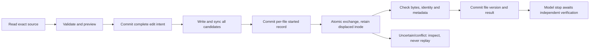

# Native repository snapshots and edits, 1 November 2026

The `native-repository-edits-2026-11-01` checkpoint connects the bounded Zig driver to explicitly granted repository files. It implements immutable file snapshots, scoped version refs, byte-range replacements, multi-file previews/publication, retained displaced inodes, native metadata copying, explicit versioned undo and conservative recovery. It advances ZR-03/04/05/06/10/12; those complete subsystem contracts remain open. Command execution, general sandboxing, Git inventory/indexing, unified-diff input and the full coding workflow are still required.

The later `native-isolated-execution-2026-11-01` checkpoint adds scoped command/result tools, schema four and 163 passing native tests; see [isolated execution](isolated-execution.md). This document's schema-three/144-test results remain historical evidence at the repository-editing tag. Current implementation bytes are recorded by `../evidence/CURRENT_SOURCE.sha256`; use the named tag for historical bytes. The prior task-driver source was `8a0f2594c624eb251a12560a478c1da8040c34a9`. Schema-one/two fixtures are frozen from earlier revisions; `src/fixtures/task-v2.sql` was extracted from that task-driver tag. All first-party runtime/tests are Zig, with SQL data and no Python or shell implementation.

## Scope and source identity

The host attaches `agent.Options.repository`. `Repository.open` requires a physical absolute root and an exact list of relative file paths, each with an optional write grant. The model cannot grant itself paths or permissions. The tool schema adds repository inspection only when a repository is attached, and adds `patch`/preview only when at least one path is writable. Context-only callers retain their existing schemas. See the executable examples in `src/agent_tests.zig`.

Path validation rejects absolute/traversing/empty/control-character components, backslashes, `.git`, runtime-private names and recovery filenames. Parent directories are opened component by component without following symlinks, using syncable directory handles. Final file opens are no-follow and nonblocking, avoiding a FIFO hang if its type changes. Reads reject nonregular and multiply linked files. Root/parent identities are rechecked. The active SQLite store, its normal sidecars and a renamed main-store inode cannot be granted/read as repository source. These are capability checks, not an OS sandbox; hostile namespace changes still require the stronger isolation contract below.

`inspect repo.paths` exposes the granted paths. `repo.read` captures a bounded complete permitted original and returns a byte page, total length, BLAKE3, repository scope and `fN:vN` reference. A page splitting UTF-8 is base64. `repo.version` retrieves an immutable older version subject to the current path grant. The configured provider credential is checked before new source/candidate bytes enter the blob store or a file effect starts. This guard covers the configured key, not every possible secret in a project.

File content and metadata have separate fingerprints. Unchanged observations retain a ref; observed changes create a new version. A changed underlying file identity creates a new entity unless the engine has the explicit lineage of its own successful replacement. This does not establish cross-rename/symbol identity or exclude every possible inode-reuse ambiguity. Watcher/Git reconciliation and the complete semantic graph remain open.

Schema version 3 adds five repository/edit tables and an immutable per-action `management` classification. Migration from version 2 maps its existing context mutations into management operations, preserving prior action data. New productive file edits consume tool/request budgets while remaining outside the context-management cap. Their call/result evidence survives later management-history projection. Version-one/two migration tests preserve source bytes, generation and prior records.

## Publication and recovery

`inspect repo.preview` checks the scope, current generation, exact current file versions, permissions/metadata, UTF-8 boundaries, replacement ordering, duplicate targets and batch limits. It shows the base ref/hash and a separately labelled candidate; preview creates no edit intent or filesystem write. `patch repo.apply` repeats this validation before publication. Limits are 1 MiB per file, eight files per batch, 32 ordered replacements per file and 64 KiB per returned source page. Existing files are supported; create/delete/rename and unified-diff parsing are pending.



The journal commits immutable before/after blobs, base refs, recovery names and parent identities before creating stages. Candidate files use exclusive random names in their target parent. Native metadata copying preserves permissions/ownership, ACLs and extended attributes; metadata fingerprints must match. Source files with unsupported ownership/special modes or uncopyable metadata fail closed. Files and parent directories are synchronized; SQLite uses WAL/FULL plus its `fullfsync` option, and macOS file stages use `F_FULLFSYNC`.

Before each exchange, the generation, root, parent and current bytes/metadata are checked again, and a `started` record is committed. macOS uses `renameatx_np(SWAP)`; Linux uses `renameat2(EXCHANGE)`. The displaced inode remains under the journaled recovery name. The engine verifies displaced/current bytes, identities and metadata before committing the new file version. Every failure after intent publication requires inspection; it does not blindly repeat an exchange, delete recovery files or roll back over a possible user edit. Result acknowledgement failure also preserves uncertainty. A failed journal update is reported separately rather than treated as a known clean failure.

**The batch is not globally atomic.** An interruption can leave an earlier file published and later files untouched. Each file's progress remains recorded. Atomic exchange also is not a content compare-and-swap: a writer racing the last check can cause conflict detection after the target path has changed. The observed race fixture preserves that writer's bytes at the retained name and enters attention. It does not prove that an uncooperative writer's target path was never replaced. Complete shared-workspace isolation/conflict UX remains required before claiming ZR-10/12 complete.

`recoverAfterOwnerExit` is a trusted host operation after the previous owner is proven gone; a journal state alone is not proof of process exit. It marks interrupted batches for attention without performing filesystem actions. `acknowledge` only records host review; it is not verification or replay authorization. `undo` is a fresh edit against explicitly supplied current refs and a new journal record. Retained inodes are not automatically garbage-collected. Full retention/backup/export and interactive reconciliation remain open.

## Evidence and source boundaries

Observed native suite: **144/144 passed** (140 core, two CLI parser, one CLI subprocess and one process-recovery test). Eighteen tests were added to the previous 126-test checkpoint: 14 repository tests, three driver tests and one subprocess test. The process test creates separate fixtures and SIGKILLs an owned child after staging and after exchange, waits for its actual signal termination, then reopens storage and checks both file versions and the no-replay gate. Fault hooks exist only in test/test-helper builds; the normal application does not expose them.

Tests also cover same-inode changes versus replaced files, explicit undo, stale preflight, overlap/UTF-8/newlines, every publication checkpoint, a final-check writer race, partial multi-file publication, configured-key assembly/echo rejection, symlink/hardlink/root checks, active-store protection, executable mode/user attributes/macOS ACL preservation, allocation failures through final tool acknowledgement, failed SQLite receipts, schema-two migration, productive-history retention, read-only schemas and whole-burst validation. The native report is `../evidence/2026-11-01-repository-native-tests.txt`.

`zig build test-build` builds/installs the four test executables, the CLI and the crash helper without executing them. The static Linux x86_64-musl `safe` report is `../evidence/2026-11-01-repository-linux-build.txt`. This is link/build evidence, not Linux execution. The local Docker context points to an absent Colima socket; no daemon/container was started to manufacture a runtime result. Linux, disk-full, power-loss and real-model results remain unverified.

The reverse-engineer-anything source workflow was used for relevant local Zig/OS mechanisms; no shipped application needed REA analysis. A read-only worker established the difference between preserve/exchange flags, Linux `O_PATH` directory handles and POSIX sync, then stopped on a usage limit. The main agent verified the relevant pinned Zig 0.17 sources and primary OS manuals. This was not a complete reference-harness audit or a general security audit.

- Linux documents exchange of two existing names, including differing object types; this motivated post-exchange checks and retention rather than a claim of atomic content CAS. [Linux rename manual](https://man7.org/linux/man-pages/man2/rename.2.html)
- Apple's metadata-copy API operates on open descriptors and supports POSIX metadata, ACLs and extended attributes. The implementation uses its metadata flags and verifies fingerprints. [Apple copyfile manual](https://developer.apple.com/library/archive/documentation/System/Conceptual/ManPages_iPhoneOS/man3/copyfile.3.html)
- Apple's sync documentation distinguishes host-buffer synchronization from the stronger drive-flush request. A passing SIGKILL test is not a power-loss test. [Apple fsync manual](https://developer.apple.com/library/archive/documentation/System/Conceptual/ManPages_iPhoneOS/man2/fsync.2.html)
- ACL retrieval/serialization uses the installed SDK ABI. The local fixture established that a valid open file without an extended ACL can return `ENOENT`; other errors remain failures. ACL copying was exercised using an actual temporary-file ACL. [Apple ACL retrieval manual](https://developer.apple.com/library/archive/documentation/System/Conceptual/ManPages_iPhoneOS/man3/acl_get_fd.3.html)

## Reproduction and next work

Working directory: `/Users/utkarshrajput/Library/Application Support/Local AI Workspaces/ChatGPT/Harness`. The compatibility path under Documents resolves here; no new AI files were placed in iCloud Drive. Compiler/cache/runtime/recovery data remain local.

```sh
zr_zig=/Users/utkarshrajput/.cache/zerorepeat/bootstrap/zig-aarch64-macos-0.17.0/zig
"$zr_zig" fmt --check src build.zig
"$zr_zig" build test --cache-dir /Users/utkarshrajput/.cache/zerorepeat/zig-local --summary all
"$zr_zig" build --cache-dir /Users/utkarshrajput/.cache/zerorepeat/zig-local --prefix /Users/utkarshrajput/.cache/zerorepeat/build/native --summary all
"$zr_zig" build test-build -Dtarget=x86_64-linux-musl -Doptimize=safe --cache-dir /Users/utkarshrajput/.cache/zerorepeat/zig-local --prefix /Users/utkarshrajput/.cache/zerorepeat/build/linux-tests --summary all
```

Next: policy-backed isolated command execution, bounded result capture and actual inspect/edit/test/repair/verify through the same driver. Retain unified diffs, create/delete/rename, Git/index/LSP, safe task CLI/resume, general sessions/branches, exact input/delegation/cost budgets and all other release requirements. Construction cloud spend remains US$0; no weights, credentials or paid resources were acquired. No model-quality, benchmark or token/time-saving claim follows from these tests.
