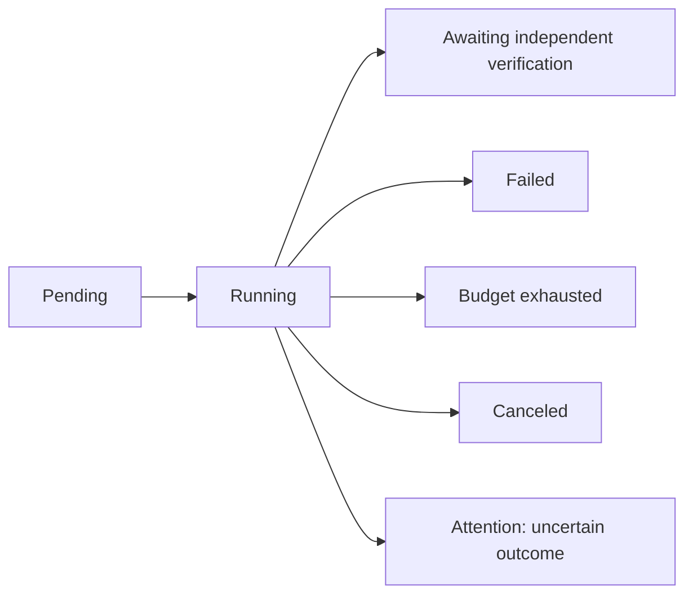

# Native bounded task driver, 30 October 2026

This checkpoint adds the exported Zig `task` journal and `agent.run` driver. It connects the native Chat Completions modules to context operations through the same typed boundary for scripted and HTTP providers. The current executable still exposes development context/continuity commands. Repository inspection/editing, isolated commands, the task CLI, independent verification, general resume and the full coding workflow remain required work under `../PLAN.md`.

Implementation source revision: tag `native-task-driver-2026-10-30`. Exact source/build/dependency bytes are in `../evidence/CURRENT_SOURCE.sha256`. The prior transport revision was `10f5e68f25ef97d8dbd904ca79d2479b43f96e9e`; the schema-one fixture was extracted from `8a1b6fc35f8526c28f2d82bf7d45fdb3392527e4:src/context.zig`, with the original SQL retained in `src/fixtures/context-v1.sql`.

## State and effect boundaries

`Journal.create` binds a task to an existing visible user text event. `addRequirement` is a trusted host operation for registering subsequent corrections; it cannot promote assistant/tool text to user authority. Every registered source remains protected from folding until explicit task cancellation. Transient guidance names this task's sorted requirement refs, whose full bytes are in the compiled context. Other retained user messages do not automatically become this task's goals. An idempotent requirement registration does not change the context generation. Automatic extraction of obligations from arbitrary conversation, verification-based retirement and complete plan/job states are still open.

Only a pending task can be claimed. The claim is committed in an immediate SQLite transaction, so a second claimant fails. A returned model stop changes the state to `awaiting_verification`; it never marks work verified or complete. Length/filter finishes, unsupported calls and repeated identical failures stop the driver. Cancellation is idempotent. Known failures, exhausted budgets and requests/actions with uncertain outcomes remain distinguishable.



Before a request, the journal commits its exact encoded payload, source generation and output reservation. Before any tool effect, the driver validates the complete reply and decodes every invocation, reserves the entire burst and durably records each intent. Each action receives a separate committed `started` event immediately before execution. A durable result records success or a known error afterward. Provider call IDs are retained as aliases; reconstructed exchanges use unique native action IDs such as `a7`, so an upstream provider may reuse an ID in a later completion without joining distinct actions. Repeated completion IDs within one task are rejected before another action starts.

No action is replayed automatically. `recoverAfterOwnerExit` is a trusted host entrypoint, called only after confirming the prior owner is gone. It marks planned-but-unstarted actions `abandoned`, started actions without results `uncertain`, and the task `attention`. It preserves arguments, known partial results and original source. Attention/cancellation advances the generation, rejecting late context mutations with an earlier generation. This is not a process supervisor, cross-process owner liveness detector or a full filesystem-effect fence.

A result acknowledgement can fail after the context mutation committed. `CommittedResultUnavailable`, result-store failure and interrupted execution leave conservative uncertainty. If the journal itself cannot record the failure, the driver returns `JournalUnavailable`; retained `running`/`started` records then require explicit inspection/recovery. It does not guess success or repeat the effect.

## Working context versus audit history

Every request includes a freshly compiled self-contained context, real system-source instructions and one current runtime-guidance tail. No prior transmission or object handle is treated as residency. All completed read exchanges are reconstructed, including their arguments, results and returned reasoning. The newest management exchange is also included. Older pure management exchanges with empty assistant content may be excluded from the next prompt; their full permitted reply fields and results remain in the journal. Mixed read/mutation bursts and nonempty model findings remain in the working history. This policy has only scripted/local validation; summary quality and real-model reasoning effects remain unmeasured.

Exact provider payloads, normalized complete reply records, tool argument bytes and tool result bytes are stored as immutable verified BLAKE3 blobs. This archive does not retain raw SSE frame boundaries or arbitrary rejected server text. Typed journal metadata uses SQLite columns; JSON stays at the provider/tool boundary. Audit payloads do not manufacture ordinary source messages or increment projection generation. The compiled source prefix changes when source/projection changes, while generation and remaining budgets travel in transient guidance. Current request payloads necessarily retain that guidance as audit evidence; it is not appended into future model history.

Registered task requirements extend the existing protection query. Schema version 2 adds five journal tables inside one migration transaction. Version-one source/event identities, hashes, message references and generation are preserved. An unsupported future or incomplete version-two schema is rejected. A migration collision rolls back newly created tables and leaves the old version intact. Like existing context initialization, a successful ownership check precedes WAL configuration; a later migration failure may leave journal mode configured, but does not publish a partial migration.

## Bounds, accounting and credentials

The durable limits cover total requests, submitted tool calls, mutation-bearing management rounds, encoded request bytes, reserved/observed output tokens, per-request output and elapsed time. A whole burst that exceeds its tool/management budget starts no action. Unknown response usage consumes its requested output ceiling; it is never reported as measured usage. Returned input/output, optional cached-input and returned-reasoning totals have separate known-request counts. Cached/reasoning counts are subsets, not extra tokens. Repeated identical `(operation, arguments, failure)` stops on the second failed attempt. Requests, rejections and interrupted requests are retained in aggregate accounting.

An absolute task deadline and caller cancellation cancel and join a cooperative provider. Native context effects are bounded synchronous transactions; there is no preemption of arbitrary SQLite/CPU work. HTTP transport keeps its own stricter deadline if configured. No retry or redirect is automatic. No first-party tokenizer or full chat-template input-token budget exists yet; source compilation uses its configured counter, while complete encoded requests have byte limits. Observed input totals are recorded, not a claim of complete input/cost accounting. Delegation and cost budgets, exact full-request token limits and pressure-triggered autonomous compaction remain open before cloud validation.

The HTTP adapter takes an explicitly supplied key. The driver checks that configured key in requests, reply text/reasoning/IDs, decoded tool arguments and JSON tool results before their new audit publication or an effect. A detected echo fails closed; no credential is persisted in the test records. This is a guard for the configured credential, including JSON escapes, not a universal secret detector or redaction system. No credential environment discovery, proxy installation or client-configuration change occurs.

## Source investigation and provenance

The reverse-engineer-anything source workflow was used, with one independent read-only worker. These were complete source entrypoints, so no artifact/runtime REA operation was required. No upstream implementation was copied.

- Pi's pinned context code derives model messages from immutable committed entries, incrementally reuses an unchanged head and rebuilds after context edits. Its missing-result projection supplies an error but this entrypoint does not distinguish whether the action began. This supports explicit projection invalidation and retention of original events. Search boundary: [Pi `context.ts`, revision `6c2fd73b0c545a4034672cb60e34d53e035dd751`, lines 19–40, 68–108, 146–181, 222–231 and 299–333](https://github.com/earendil-works/pi/blob/6c2fd73b0c545a4034672cb60e34d53e035dd751/packages/durable/src/harness/context.ts).
- dsh separates append events from a surface-derived model view and exposes an awaited durability flush; an in-memory append alone is not proof of disk persistence. Its repair code distinguishes never-started calls from started calls whose results are unknown. These are source-established mechanisms, not observed executions. Search boundary: [dsh `session/index.ts`, revision `22ddee3792402c3e70ec5f86a63c3e3e895a2f60`, lines 764–788, 827–836, 892–911, 979–1029 and 1334–1358](https://github.com/deepseek-ai/deepseek-harness/blob/22ddee3792402c3e70ec5f86a63c3e3e895a2f60/packages/core/session/src/index.ts), and [its `repair.ts`, lines 53–97, 116–193 and 200–210](https://github.com/deepseek-ai/deepseek-harness/blob/22ddee3792402c3e70ec5f86a63c3e3e895a2f60/packages/core/session/src/repair.ts).

The worker also cross-checked the native journal/driver failure boundaries. It found that shared-context tasks lacked model-visible source bindings; explicit sorted requirement refs and a two-task fixture correct that ambiguity. No additional actionable defect was found in that bounded source review. Persistence plugins, effect executors and reference-project test suites were not inspected or run. Pi/dsh reference rows remain in progress; this review does not complete either full feature audit or a general security audit.

## Local acceptance evidence and remaining work

The integrated suite passes **126/126 tests** (123 core, two CLI parser, one CLI subprocess), including 26 new driver/journal regressions. The raw report is `../evidence/2026-10-30-task-driver-integrated-tests.txt`. It covers the native driver, real loopback two-request fold/stop, nonce retrieval into the next request, user correction protection, separate shared-context task bindings, whole-burst rejection, aggregate caps, unknown usage, duplicated completions, repeated failures, stale responses, timeout/caller/host cancellation, configured-secret echoes, allocation failure, migration/collision, incomplete schemas, generation exhaustion and interrupted effect/result recovery. It retains all earlier context/protocol/CLI tests. The acknowledgement fault is an injected SQLite trigger; interruption is committed-boundary close/reopen. A process kill, disk-full crash or real model was not used.

The macOS native build and static Linux safe CLI build are recorded in the matching `task-driver-{native,linux}-build.txt` reports. Root tests are semantically cross-compiled for Linux with `-fno-emit-bin`, including the driver functions exercised by tests. No Linux execution or real HTTPS/model server is claimed. The CLI has no live inference command in this construction stage.

Executed checks (working directory is the repository root; every command exited 0 except the deliberately incomplete release gate, which exited 1):

```sh
zr_zig=/Users/utkarshrajput/.cache/zerorepeat/bootstrap/zig-aarch64-macos-0.17.0/zig
"$zr_zig" fmt --check src
"$zr_zig" build test --cache-dir /Users/utkarshrajput/.cache/zerorepeat/zig-local --summary all
"$zr_zig" build --cache-dir /Users/utkarshrajput/.cache/zerorepeat/zig-local --prefix /Users/utkarshrajput/.cache/zerorepeat/build/native --summary all
"$zr_zig" build -Dtarget=x86_64-linux-musl -Doptimize=safe --cache-dir /Users/utkarshrajput/.cache/zerorepeat/zig-local --prefix /Users/utkarshrajput/.cache/zerorepeat/build/linux-x86_64-musl --summary all
"$zr_zig" test src/root.zig -target x86_64-linux-musl -lc -fno-emit-bin --cache-dir /Users/utkarshrajput/.cache/zerorepeat/task-driver-tests
/Users/utkarshrajput/.cache/zerorepeat/build/native/bin/zerorepeat doctor
/Users/utkarshrajput/.cache/zerorepeat/build/native/bin/zerorepeat continuity check
/Users/utkarshrajput/.cache/zerorepeat/build/native/bin/zerorepeat continuity check --release
```

The semantic-compile receipt is `../evidence/2026-10-30-task-driver-linux-compile.txt`; continuity passes with all 70 rows retained, and release mode fails with 28 required items and 25 reference audits open. No subsystem was marked complete from these component tests.

Next implement repository reads and expected-version editing, then isolated execution and the complete inspect/edit/test/repair/verify loop. Keep independent verification, explicit safe resume/reconciliation, task CLI/events, pending jobs, model/template/session binding, exact input/delegation/cost budgets, provider variants and all remaining full-harness contracts visible. No official benchmark, token/time-saving result or competitor parity exists. Construction cloud spend remains US$0; the US$7 budget is untouched.
